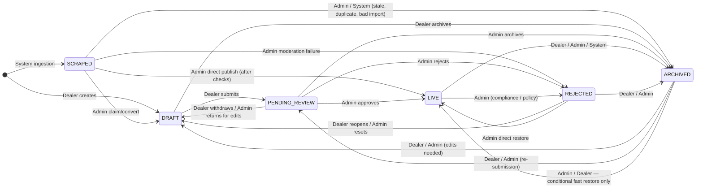

# RE Trends — Property Listing Lifecycle: State Transition Model

**Document type:** Engineering RFC / Backend source of truth
**Version:** 2.2
**Status:** Authoritative — supersedes all prior lifecycle notes
**Related documents:**
- [VERIFICATION_TRUST_SPEC.md](./VERIFICATION_TRUST_SPEC.md) — trust/badge system (orthogonal to this lifecycle)

---

## 1. Problem Statement

The listing lifecycle has grown organically across sprints with no formal state machine. Transition logic is scattered across seven methods in `ListingService.java`. There is no authoritative definition of which actor may move a listing between which states, under what conditions, or what side effects are required. This creates:

- **Correctness risk:** Different methods apply different (and sometimes conflicting) status guards.
- **Data integrity risk:** Booking and viewing-request state is not cleaned up on listing status changes.
- **Product gaps:** Brokers have no way to take a live listing offline without admin rejection. There is no way to withdraw a submission from review. SCRAPED listings have no defined management path.
- **Market motivation:** Stale listings are the single largest complaint about 99acres and MagicBricks. Brokers currently abandon listings because the system gives them no lifecycle controls.

This RFC defines the complete, canonical lifecycle state machine and is the authoritative reference for all backend work touching listing status.

---

## 2. Goals

1. Define the canonical set of listing statuses and their exact semantics.
2. Define every legal status transition, the actor who may trigger it, and the guard conditions that must be satisfied.
3. Define the side effects that must occur on each transition.
4. Define how bookings and viewing requests are handled when a listing changes status.
5. Define the distinct behavior of SCRAPED listings versus broker-authored listings.
6. Provide a persistence model that supports full audit history.
7. Provide an API command model that makes the state machine legible to API consumers.
8. Serve as the single place an engineer reads to understand the listing lifecycle.

---

## 3. Non-Goals

1. This document does not define the trust/verification badge system. Trust state is orthogonal to lifecycle state and is specified in [VERIFICATION_TRUST_SPEC.md](./VERIFICATION_TRUST_SPEC.md).
2. This document does not define the booking or viewing-request lifecycle beyond how listing status changes affect open requests.
3. This document does not specify UI implementation details beyond what is needed to derive API requirements.
4. The UNDER_OFFER status is out of scope. It requires a transaction/offer flow that does not exist. It is deferred to a future phase.
5. Hard deletion and GDPR erasure flows are out of scope of this lifecycle specification and are governed by the platform data-retention policy.

---

## 4. Canonical Statuses

The following six statuses are the complete and closed set for this version. No additional values exist. Future status additions require an RFC amendment.

| Status | Short definition |
|--------|-----------------|
| `SCRAPED` | Externally imported. Not part of the authored workflow until claimed. |
| `DRAFT` | Created by a broker/owner. Editable. Not public. |
| `PENDING_REVIEW` | Submitted for moderation. Locked. Not public. |
| `LIVE` | Approved. Public. Accepts new bookings and viewing requests. |
| `REJECTED` | Moderation, compliance, or policy failure. Reason code required. |
| `ARCHIVED` | Intentionally taken offline or superseded. Preserved. Not a moderation failure. |

---

## 5. Status Definitions

### 5.1 SCRAPED

A SCRAPED listing is externally sourced — imported from a third-party data feed, a partner portal, or an internal ingestion pipeline. It is not part of the normal broker-authored workflow and must not be treated as one.

SCRAPED listings may be:
- Incomplete, duplicate, stale, or unclaimed.
- Missing fields required for submission.
- Not associated with a registered broker account.

A SCRAPED listing enters the authored workflow through an explicit **claim/convert** action by an admin (SCRAPED → DRAFT, T-11). An admin may also exceptionally direct-publish a SCRAPED listing to LIVE (T-12) when no editing or normalization is needed — this is not the normal claim path. Until one of these actions is taken, brokers may not edit a SCRAPED listing. See §13 for the complete SCRAPED policy.

### 5.2 DRAFT

A DRAFT listing is created by a broker or owner. It is fully editable and is not visible to buyers or the public. A DRAFT listing may be submitted for review when it satisfies completeness guards (§10.2). A DRAFT listing may be archived (taken permanently offline) by its owner.

### 5.3 PENDING_REVIEW

A PENDING_REVIEW listing has been submitted for admin moderation. Listing content fields are locked for both the broker and admin during this period. Admin may still record moderation metadata (internal notes, structured review outcomes, reason codes, and decision data) without this constituting a content edit. It is not public. The broker may withdraw it back to DRAFT before the admin takes a terminal action (approve or reject). Admin may return it to DRAFT for edits with a note.

### 5.4 LIVE

A LIVE listing is approved, public, and searchable. It is the only status in which new bookings and viewing requests may be created. It is locked for editing — a broker who needs to edit must first archive the listing (LIVE → ARCHIVED), then explicitly reopen it as a DRAFT (ARCHIVED → DRAFT). Only after that reopen step may content changes be made and the listing resubmitted for review. Archiving alone does not make the listing editable.

LIVE does not transition directly to DRAFT.

### 5.5 REJECTED

A REJECTED listing has failed moderation, compliance, or policy review. REJECTED is only used for moderation/compliance failure — not for a broker wanting to take a listing offline (that is ARCHIVED). A rejection always requires a reason code. The broker receives a notification with the reason. All data, media, and history are preserved. The broker may reopen to DRAFT to address the issue.

REJECTED is not a terminal state. It is an actionable moderation failure state.

### 5.6 ARCHIVED

An ARCHIVED listing is intentionally offline and preserved. It is used when a broker wants to take a listing off the market, when an admin needs to remove a listing for non-moderation reasons (e.g., confirmed duplicate, operational cleanup), or when the system takes automated action (e.g., duplicate detection). ARCHIVED is not a moderation failure and carries no negative signal.

All data, media, audit history, and analytics are preserved in ARCHIVED. An ARCHIVED listing is not directly editable. Content changes require restoring to DRAFT first (ARCHIVED → DRAFT). Preservation of data does not imply live editability. An ARCHIVED listing can be restored to DRAFT (for editing), to PENDING_REVIEW (for re-submission), or conditionally to LIVE (fast restore, see §10.4).

---

## 6. Key Design Decisions

| # | Decision | Rationale |
|---|----------|-----------|
| D-1 | ARCHIVED is the default "take offline" state. | Separates voluntary offline action from moderation failure. Brokers should not be stigmatized for temporarily removing a listing. |
| D-2 | REJECTED is only for moderation/compliance failure. | Overloading REJECTED for "broker wants listing offline" would contaminate analytics, notifications, and trust signals. |
| D-3 | LIVE does not transition directly to DRAFT. | LIVE → DRAFT would produce a state where a previously-public listing is privately editable with no intermediate audit record of it going offline. The correct path is LIVE → ARCHIVED → DRAFT. |
| D-4 | Broker can archive a LIVE listing. | Self-service offline control is a core product requirement. Brokers should not need admin action to take their own listing offline. |
| D-5 | Broker can withdraw from PENDING_REVIEW. | A broker who realizes their submission is incomplete or premature should not be forced to wait for an admin rejection. Withdrawal preserves data and avoids wasting moderation time. |
| D-6 | ARCHIVED → LIVE is conditional. | Direct restore is only valid when the listing is materially unchanged and its compliance data is still valid. Otherwise the correct path is ARCHIVED → PENDING_REVIEW to re-enter the moderation queue. |
| D-7 | SCRAPED is an ingestion state, not a normal authored state. | SCRAPED listings are externally sourced and may be incomplete or duplicate. Treating them as normal DRAFTs would pollute the authored listing pool and skip moderation for externally-sourced content. |
| D-8 | System-triggered REJECTED is discouraged. | Automated moderation without auditable, human-readable reason codes violates the requirement that REJECTED always carries a specific reason. Automated systems should prefer ARCHIVED with a system reason code. |
| D-9 | Transition validation must be centralized in a single policy module. | Implementation technology is a service-layer architecture decision. |
| D-10 | All status changes are audit logged. | Both application-level fields and a `listing_status_history` table ensure the full status history is recoverable. |

---

## 7. Actor Model

Three actor types may trigger status transitions. Guards that reference "actor authority" verify that the calling actor is authorized for the target listing and holds the required role.

| Actor | Description |
|-------|-------------|
| `DEALER` | A registered broker or property owner. May only act on their own listings. |
| `ADMIN` | A platform moderator or operator. May act on any listing. |
| `SYSTEM` | Automated process: ingestion pipeline, duplicate detection, scheduled job. No user context. |

---

## 8. Lifecycle Diagram



**Transitions not shown (prohibited):**
- LIVE → DRAFT (must go via ARCHIVED)
- Any → SCRAPED (SCRAPED is entry-only via ingestion)
- Dealer self-publish to LIVE (any path)

---

## 9. Transition Matrix

### 9.1 Generic Guards (apply to every transition)

All transitions must satisfy these baseline guards before any transition-specific guard is evaluated:

1. Calling actor has authority over the listing (ownership or admin role).
2. Current listing status matches the expected source state.
3. The transition `(from, to, actor)` is in the allowed transition matrix (§9.2–9.4).
4. Target status differs from current status.
5. A status history record is written atomically with the status update.

### 9.2 Dealer / Owner Transitions

| # | From | To | API command | Transition-specific guards | Side effects |
|---|------|----|-------------|---------------------------|-------------|
| T-01 | *(new)* | DRAFT | `createListing` | Active account; listing count within limit | Assign `listing_id`; set `created_at` |
| T-02 | DRAFT | PENDING_REVIEW | `submitForReview` | Completeness guard (§10.2) | Set `review_submitted_at`; lock listing |
| T-03 | DRAFT | ARCHIVED | `archiveListing` | Ownership | Set `archived_at`; block new requests; reason code optional (recommended) |
| T-04 | PENDING_REVIEW | DRAFT | `withdrawListingFromReview` | Admin has not taken terminal action on this submission | Clear `review_submitted_at`; unlock listing; preserve all history |
| T-05 | LIVE | ARCHIVED | `archiveListing` | Ownership | Set `archived_at`; remove from search index; block new requests; handle open requests (see §12); reason code optional (recommended) |
| T-06 | REJECTED | DRAFT | `reopenRejectedListing` | Ownership | Unlock for editing; do not clear `rejected_at` or `status_reason_code` on the listing row — prior rejection is preserved in `listing_status_history`; append a new history row |
| T-07 | REJECTED | ARCHIVED | `archiveListing` | Ownership | Set `archived_at`; preserve all moderation history; reason code optional (recommended) |
| T-08 | ARCHIVED | DRAFT | `reopenArchivedListingAsDraft` | Ownership; account in good standing | Clear `archived_at`; unlock for editing; preserve history |
| T-09 | ARCHIVED | PENDING_REVIEW | `submitForReview` | Completeness guard (§10.2); account in good standing | Set `review_submitted_at`; lock listing |
| T-10 | ARCHIVED | LIVE | `restoreArchivedListing` | Fast restore guard (§10.4) | Clear `archived_at`; set `last_live_at`; re-index; enable requests |

Dealer may **not**:
- Self-publish to LIVE by any path.
- Move any listing to REJECTED.
- Act on SCRAPED listings directly. Brokers must use a dedicated claim flow (when available) which admin mediates.

### 9.3 Admin Transitions

| # | From | To | API command | Transition-specific guards | Side effects |
|---|------|----|-------------|---------------------------|-------------|
| T-11 | SCRAPED | DRAFT | `claimScrapedListing` | Post-import checks passed; ownership must be assigned to a broker or owner account | Set `converted_from_scraped_at`; assign `owner_id` or `dealer_id`; unlock for editing |
| T-12 | SCRAPED | LIVE | `approveScrapedListing` | Completeness guard (§10.2); record moderation metadata. **Exceptional admin direct-publish override** — not the normal path for imported inventory. Use only when no editing or normalization is needed. | Set `first_published_at`, `last_live_at`, `approved_at`, `approved_by`; index; enable requests |
| T-13 | SCRAPED | REJECTED | `rejectListing` | Reason code required | Set `rejected_at`; set `status_reason_code` |
| T-14 | SCRAPED | ARCHIVED | `archiveListing` | — | Set `archived_at`; preserve import metadata; reason code required |
| T-15 | DRAFT | LIVE | `approveListing` | Completeness guard (§10.2); record moderation metadata. **Exceptional override** — normal dealer path is DRAFT → PENDING_REVIEW → LIVE. Requires audit justification. | Set `first_published_at`, `last_live_at`, `approved_at`, `approved_by`; index; enable requests; notify dealer |
| T-16 | DRAFT | REJECTED | `rejectListing` | Reason code required | Set `rejected_at`, `status_reason_code`; notify dealer |
| T-17 | DRAFT | ARCHIVED | `archiveListing` | — | Set `archived_at`; reason code required; notify dealer |
| T-18 | PENDING_REVIEW | LIVE | `approveListing` | Completeness guard (§10.2); record moderation metadata | Set `last_live_at`, `approved_at`, `approved_by` (set `first_published_at` if first approval); index; enable requests; notify dealer |
| T-19 | PENDING_REVIEW | REJECTED | `rejectListing` | Reason code required | Set `rejected_at`, `status_reason_code`, `rejected_by`; notify dealer |
| T-20 | PENDING_REVIEW | DRAFT | `returnForEdits` | "Return for edits" note required | Clear `review_submitted_at`; unlock; preserve history; notify dealer with note |
| T-21 | PENDING_REVIEW | ARCHIVED | `archiveListing` | — | Set `archived_at`; notify dealer; reason code required |
| T-22 | LIVE | ARCHIVED | `archiveListing` | — | Set `archived_at`; remove from index; block requests; handle open requests (see §12); reason code required; notify dealer |
| T-23 | LIVE | REJECTED | `rejectListing` | Reason code required; use for compliance/policy enforcement only | Set `rejected_at`, `status_reason_code`; remove from index; block requests; cancel all open requests (see §12); notify dealer |
| T-24 | REJECTED | DRAFT | `reopenRejectedListing` | — | Unlock; preserve `rejected_at`, `status_reason_code`, and prior moderation notes — do not erase prior rejection record; append a new history row only |
| T-25 | REJECTED | LIVE | `restoreRejectedListing` | Completeness guard (§10.2); explicit admin override with moderation note. **Rare exceptional override** — for admin error correction or upheld appeal only. Normal correction path is REJECTED → DRAFT → PENDING_REVIEW → LIVE. | Set `last_live_at`; index; enable requests; notify dealer |
| T-26 | REJECTED | ARCHIVED | `archiveListing` | — | Set `archived_at`; reason code required |
| T-27 | ARCHIVED | DRAFT | `reopenArchivedListingAsDraft` | — | Clear `archived_at`; unlock |
| T-28 | ARCHIVED | PENDING_REVIEW | `submitForReview` | Completeness guard (§10.2) | Set `review_submitted_at`; lock |
| T-29 | ARCHIVED | LIVE | `restoreArchivedListing` | Fast restore guard (§10.4) | Clear `archived_at`; set `last_live_at`; index; enable requests |

**Note on T-15:** This is an operational override. The standard publication path for dealer-authored listings is submission through PENDING_REVIEW (DRAFT → PENDING_REVIEW → LIVE). Use T-15 only when skipping moderation is explicitly justified, recorded in moderation metadata, and audited.

### 9.4 System Transitions

| # | From | To | Trigger | Transition-specific guards | Side effects |
|---|------|----|---------|---------------------------|-------------|
| T-30 | *(new)* | SCRAPED | Import pipeline | Idempotent external ID check | Set `scraped_at`, source metadata |
| T-31 | SCRAPED | ARCHIVED | Deduplication / staleness job | Automated reason code required (e.g., `DUPLICATE_IMPORT`, `STALE_IMPORT`) | Set `archived_at`, `status_reason_code` |
| T-32 | LIVE | ARCHIVED | Conditional operational automation | Explicit automated trigger and auditable reason code required (e.g., `DUPLICATE_CONFIRMED`) | Set `archived_at`, `status_reason_code`; remove from index; block requests; handle open requests (see §12) |

**System should not auto-set REJECTED** unless an automated moderation model exists with explicit, auditable reason codes. When in doubt, system automation should archive rather than reject.

---

## 10. Guard Conditions

### 10.1 Actor Authority Guard

- For DEALER: `listing.owner_id == caller.user_id` OR `listing.dealer_id == caller.dealer_id`.
- For ADMIN: caller holds admin role.
- For SYSTEM: service account or internal process with no user context.

### 10.2 Completeness Guard (entering review or live)

Applies to transitions: T-02, T-09, T-12, T-15, T-18, T-25, T-28.

All of the following must be satisfied:

| Check | Condition |
|-------|-----------|
| Title | Non-empty string |
| Description | Non-empty string, minimum length |
| Location | Valid geocoded coordinates; locality present |
| Asset type | `asset_type` is a recognized value |
| Asset-type fields | Required fields for `asset_type` are present (e.g., `built_up_area` for apartments, `land_area` for plots) |
| Price / rent | `price` or `monthly_rent` present and > 0 depending on `listing_purpose` |
| Address confirmed | `address_confirmed = true` |
| Media | ≥ 3 images uploaded and attached to this listing |
| Fraud flags | No active blocking fraud or moderation flags on the listing or the submitting account |

### 10.3 Moderation Guards

- Any transition that sets status to REJECTED requires `status_reason_code` to be non-null. REJECTED without a reason code is a hard error.
- T-20 (PENDING_REVIEW → DRAFT, admin return-for-edits) requires a non-empty `status_reason_note` explaining what changes are needed.
- Transitions T-15, T-18, T-25 (admin publish/approve) must record `approved_by` and `approved_at`.

### 10.4 Fast Restore Guard (ARCHIVED → LIVE)

Applies to T-10, T-29.

All of the following must be satisfied:

| Check | Condition |
|-------|-----------|
| Previously published | `first_published_at IS NOT NULL` — listing was previously LIVE |
| Snapshot match | All material fields (per §10.4.1) match the values in `last_approved_snapshot` |
| Compliance currency | Trust and compliance data (e.g., broker license, KYC) still valid |
| Actor authority | Calling actor is authorized for this listing |
| Account standing | Broker/owner account is in good standing (not suspended) |

If any check fails, the transition to LIVE is blocked. The valid restore path is then ARCHIVED → PENDING_REVIEW (T-09 or T-28) for re-moderation.

#### 10.4.1 Definition of Material Change

**Material changes (require re-review — listing is not eligible for fast restore):**
- Title or description
- Price or monthly rent
- Location / map pin or locality
- Asset type
- Area or size fields (built-up area, plot area, carpet area, land area)
- Key property facts: bedrooms, bathrooms, furnishing status
- Compliance or trust documents attached to the listing
- Media additions or removals that change the public representation of the property

**Non-material changes (fast restore remains eligible):**
- Internal notes or admin-only metadata
- Non-public tags or classification labels
- Image reordering only (if platform policy permits)

The comparison check at fast-restore time must include all material fields listed above.

On every transition into LIVE via admin approval (T-15, T-18, T-25), the system captures the current values of all material fields into `last_approved_snapshot` as a JSONB object. This snapshot is the baseline for subsequent fast-restore comparisons.

### 10.5 Withdrawal Guard

Applies to T-04 (PENDING_REVIEW → DRAFT by dealer).

**Submission counter:** On every `submitForReview` transition (T-02, T-09, T-28), the `submission_count` field on the listing is incremented. This identifies the current submission window and prevents stale data from a prior submission cycle from blocking withdrawal.

**Terminal action record:** When an admin takes a terminal action (T-18 approve, T-19 reject), the corresponding `listing_status_history` row is written with `actioned_submission_count = listing.submission_count` at the time of the action.

**Guard check:** Withdrawal (T-04) is blocked if any `listing_status_history` row exists with `actioned_submission_count = listing.submission_count` AND `to_status IN ('LIVE', 'REJECTED')`. This scopes the guard to the *current* submission window — a broker who was rejected in a prior cycle and resubmitted is not blocked from withdrawing the new submission.

The system must check atomically: if the current submission has already been acted upon, return a 409 Conflict error (`SUBMISSION_ALREADY_ACTIONED`), not a silent failure.

---

## 11. Side Effects

### 11.1 On Any Transition into LIVE

1. Mark listing public (`is_visible = true`).
2. Add or update search index entry.
3. Enable new bookings and viewing requests.
4. Set `last_live_at = NOW()`.
5. Set `first_published_at = NOW()` if not already set.
6. Emit analytics event `listing.published`.
7. If the transition originated from admin approval of a dealer submission, send dealer notification "Your listing has been approved."
8. Capture `last_approved_snapshot` — serialize all material fields (§10.4.1) into the listing's snapshot column.

### 11.2 On Any Transition out of LIVE

1. Remove from public search index.
2. Block new bookings and viewing requests immediately.
3. Preserve all media, analytics, history, and audit trail.
4. Handle open requests per §12.

### 11.3 On Transition into REJECTED

1. Set `rejected_at = NOW()`.
2. Set `status_reason_code` (required, non-null).
3. Optionally set `status_reason_note` with detail for the dealer.
4. Send dealer notification with reason code and note.
5. Preserve all data, media, and history.
6. Block new bookings and viewing requests immediately.
7. Handle open requests per §12.

### 11.4 On Transition into ARCHIVED

1. Set `archived_at = NOW()`.
2. Remove from public search/browse immediately.
3. Block new bookings and viewing requests.
4. Preserve all images, documents, history, and audit trail.
5. Handle open requests per §12.
6. Set `status_reason_code`: required for admin and system transitions; recommended but optional for dealer-initiated transitions. See canonical reason codes below.

**Archive reason codes (canonical):**

| Code | Actor | When to use |
|------|-------|-------------|
| `DEALER_WITHDRAWN` | DEALER | Broker voluntarily took listing offline |
| `SOLD_OR_RENTED` | DEALER | Property is no longer available (sale or rental completed) |
| `DUPLICATE_CONFIRMED` | ADMIN, SYSTEM | Confirmed as a duplicate listing |
| `SOURCE_STALE` | ADMIN, SYSTEM | Scraped or imported listing is outdated |
| `SYSTEM_EXPIRY` | SYSTEM | Automated expiry (e.g., listing age limit reached) |
| `ADMIN_OFFLINE` | ADMIN | Admin took listing offline for operational reasons |

### 11.5 On Transition into / returning to DRAFT

1. Unlock listing for editing.
2. Preserve all moderation history — do not erase `rejected_at`, `status_reason_code`, or prior review notes.
3. Clear `review_submitted_at` if returning from PENDING_REVIEW.

---

## 12. Booking and Viewing Request Policy

### 12.1 Gate on Creation

Only LIVE listings accept new booking or viewing requests. Any attempt to create a booking or viewing request against a non-LIVE listing returns an error. This is enforced by `BookingService` and must not be bypassed.

### 12.2 Effect of Status Changes on Open Requests

| Listing transition | Open REQUESTED (pending) bookings | CONFIRMED bookings |
|-------------------|-----------------------------------|--------------------|
| any → ARCHIVED | System-cancel with `LISTING_UNAVAILABLE` | Freeze: mark `NEEDS_RESOLUTION`; block rescheduling; preserve record for manual resolution ¹ |
| LIVE → REJECTED | System-cancel with reason code from transition (e.g., `MODERATION_REJECTION`, `POLICY_TAKEDOWN`, `COMPLIANCE_FAILURE`, `FRAUD_RISK`) | System-cancel with same reason code |

¹ Frozen bookings auto-unfreeze if the listing is restored to LIVE; see §12.5.

**Note on non-LIVE → REJECTED:** DRAFT, PENDING_REVIEW, SCRAPED, and ARCHIVED listings should not normally have open confirmed requests (only LIVE listings accept new requests per §12.1). If those statuses are rejected, no booking cancellation workflow is expected because no active requests should exist.

**Reason codes for automated booking cancellation:**

| Code | When used |
|------|-----------|
| `LISTING_UNAVAILABLE` | Listing archived by broker, admin, or system |
| `MODERATION_REJECTION` | Listing rejected for moderation review failure |
| `POLICY_TAKEDOWN` | Listing rejected for policy violation |
| `COMPLIANCE_FAILURE` | Listing rejected for compliance breach |
| `FRAUD_RISK` | Listing rejected for fraud or trust signal failure |

Each automated cancellation publishes the existing booking cancellation event with `cancelled_by = "system"` and the appropriate reason code, so downstream notification listeners fire correctly.

### 12.3 ARCHIVED Is a Neutral Withdrawal

ARCHIVED is a neutral operational state — not a moderation failure. A broker or admin taking a listing offline does not necessarily invalidate confirmed appointments already made. The default policy is therefore to **preserve confirmed commitments** for manual resolution rather than to destructively cancel them. Pending (unconfirmed) requests are cancelled immediately since no appointment has been established.

REJECTED, by contrast, is a moderation or compliance failure. Confirmed bookings on a rejected listing carry a compliance risk signal and are cancelled along with pending requests.

### 12.4 Historical Requests

Cancelled or historic booking and viewing request records are preserved in the database regardless of listing status. They are not deleted.

### 12.5 Frozen Booking Resolution

`NEEDS_RESOLUTION` is a booking/viewing-request state, not a listing state. It applies when a LIVE listing transitions to ARCHIVED and confirmed appointments exist.

**Who may act:** The broker (listing owner) or an admin may transition a `NEEDS_RESOLUTION` booking to:
- `CONFIRMED` — re-confirm the appointment (e.g., the listing was briefly offline and is returning to LIVE).
- `CANCELLED` — cancel with reason code `LISTING_UNAVAILABLE`.

**Buyer receives:** "The listing has been temporarily taken offline. Your confirmed appointment is on hold pending resolution."

**Broker receives:** "You archived a listing with confirmed appointments. Please resolve them."

**Auto-unfreeze on restore to LIVE:** If the listing transitions back to LIVE (via T-10 or T-29 fast restore), all `NEEDS_RESOLUTION` bookings for that listing are automatically restored to `CONFIRMED`. Buyer and broker each receive a "Your appointment has been restored" notification.

**No auto-unfreeze on ARCHIVED → DRAFT:** If the listing transitions ARCHIVED → DRAFT (T-08, T-27), bookings remain `NEEDS_RESOLUTION` — the listing is not yet public and no appointment can be honoured.

> **Scope note:** The full booking lifecycle state machine is outside this RFC's scope (§3.2). This section defines only the interaction between listing status changes and open bookings.

---

## 13. SCRAPED Listing Policy

### 13.1 What SCRAPED Means

SCRAPED is a special ingestion/pre-ownership state. A SCRAPED listing is:
- Externally sourced (third-party portal, data partner, web crawl).
- Not yet part of the standard authored workflow.
- Potentially incomplete, duplicate, stale, or unclaimed.
- Not associated with any registered broker account until claimed.

### 13.2 What Dealers May Not Do with SCRAPED Listings

Dealers may not interact with SCRAPED listings directly in the current model. SCRAPED is not a normal editable draft. There is no dealer-facing SCRAPED state in the authored workflow. If a claim flow is introduced in a future phase, it will be mediated through a dedicated UI path (admin-reviewed) rather than through normal editing.

### 13.3 Allowed Transitions from SCRAPED

| Transition | Actor | When to use |
|------------|-------|------------|
| SCRAPED → DRAFT | Admin | Claim/convert: assign to a broker or owner account for editing before publication. Ownership must be assigned as part of the claim/convert action. |
| SCRAPED → LIVE | Admin | **Exceptional direct-publish override.** Not the normal path for imported inventory — when editing or normalization is needed, claim/convert to DRAFT first (SCRAPED → DRAFT → PENDING_REVIEW → LIVE). Use only when the imported data is complete, compliance-checked, and no content changes are required. Requires full completeness and compliance checks plus moderation metadata. |
| SCRAPED → REJECTED | Admin | Explicit moderation failure on the scraped content |
| SCRAPED → ARCHIVED | Admin or System | Stale import, confirmed duplicate, bad data, or other non-publication outcome |

**Note on unowned DRAFTs:** If unassigned imported inventory is needed in the future, it should use a distinct holding concept (e.g., SCRAPED with admin-only edit capability), not an unowned DRAFT. An unowned DRAFT is semantically invalid and breaks actor-authority guards.

### 13.4 Prohibited Transitions from SCRAPED

- SCRAPED → PENDING_REVIEW is not part of the current model. Scraped listings do not enter the normal moderation queue without being converted to DRAFT first.
- Dealers may not trigger any transition from SCRAPED.

### 13.5 RLS and Visibility

SCRAPED listings are not publicly visible. They are accessible to admins only. If a scraped listing has `is_valid = true` (set by the ingestion pipeline's quality checks), it may be surfaced in admin tooling but remains non-public until an admin takes an explicit action.

---

## 14. Invariants

The following invariants must hold at all times. A transition that would violate any invariant must be rejected.

| # | Invariant |
|---|-----------|
| I-01 | Only LIVE listings are publicly visible to buyers. |
| I-02 | Only LIVE listings accept new bookings or viewing requests. |
| I-03 | REJECTED always carries a non-null `status_reason_code`. There is no REJECTED listing without a reason. |
| I-04 | ARCHIVED is not equivalent to REJECTED. ARCHIVED does not imply any moderation failure. |
| I-05 | A dealer cannot self-publish to LIVE by any transition sequence. |
| I-06 | LIVE does not transition directly to DRAFT. The required path is LIVE → ARCHIVED → DRAFT. |
| I-07 | Every status change is recorded in `listing_status_history` atomically with the status update. |
| I-08 | Media, documents, and history are preserved across all lifecycle transitions. They are not deleted on ARCHIVED or REJECTED. |
| I-09 | SCRAPED is an ingestion state. It is not a normal authored state and may not be used as a substitute for DRAFT. |
| I-10 | A dealer may withdraw from PENDING_REVIEW only if the admin has not yet taken a terminal action on that submission. |

---

## 15. Persistence Model

### 15.1 Listing Table — Status Fields

The following fields track lifecycle state. Fields marked **existing** are already present; fields marked **add** require a migration.

| Field | Type | Existing? | Purpose |
|-------|------|-----------|---------|
| `status` | `listing_status` enum | Existing | Current lifecycle status |
| `status_changed_at` | `TIMESTAMPTZ` | Add | Timestamp of most recent status change |
| `status_changed_by_actor_type` | `VARCHAR(20)` | Add | `DEALER`, `ADMIN`, or `SYSTEM` |
| `status_changed_by_actor_id` | `UUID` (nullable) | Add | User ID of actor; null for SYSTEM |
| `status_reason_code` | `VARCHAR(100)` (nullable) | Add | Machine-readable reason for REJECTED or system ARCHIVED transitions |
| `status_reason_note` | `TEXT` (nullable) | Add | Human-readable note (for dealer notifications or admin return-for-edits) |
| `first_published_at` | `TIMESTAMPTZ` (nullable) | Add | Timestamp of first ever LIVE transition |
| `last_live_at` | `TIMESTAMPTZ` (nullable) | Add | Timestamp of most recent LIVE transition |
| `review_submitted_at` | `TIMESTAMPTZ` (nullable) | Add (rename `submitted_at` if exists) | Timestamp of most recent submission to PENDING_REVIEW |
| `approved_at` | `TIMESTAMPTZ` (nullable) | Add | Timestamp of most recent admin approval |
| `rejected_at` | `TIMESTAMPTZ` (nullable) | Add | Timestamp of most recent rejection |
| `archived_at` | `TIMESTAMPTZ` (nullable) | Existing (V35) | Timestamp of most recent archive action |
| `last_approved_snapshot` | `JSONB` (nullable) | Add | Snapshot of all material fields (per §10.4.1) captured at last approval; used for fast restore comparison |
| `submission_count` | `INTEGER NOT NULL DEFAULT 0` | Add | Incremented on each transition to PENDING_REVIEW; used to scope withdrawal guard (§10.5) |

### 15.2 Status History Table

A `listing_status_history` table provides the complete, tamper-evident audit trail. This table is written by the application on every status change. A database trigger should also write to this table as a safety net to catch any application-layer bypass.

```sql
CREATE TABLE listing_status_history (
    id                   UUID PRIMARY KEY DEFAULT gen_random_uuid(),
    listing_id           UUID NOT NULL REFERENCES property_listings(id),
    from_status          public.listing_status,        -- NULL on creation
    to_status            public.listing_status NOT NULL,
    actor_type           VARCHAR(20) NOT NULL,          -- DEALER | ADMIN | SYSTEM
    actor_id             UUID,                          -- NULL for SYSTEM
    reason_code                  VARCHAR(100),              -- required when to_status = REJECTED
    note                         TEXT,
    actioned_submission_count    INTEGER,                   -- populated on admin terminal actions (approve/reject) only; NULL otherwise
    occurred_at                  TIMESTAMPTZ NOT NULL DEFAULT NOW()
);

CREATE INDEX idx_lsh_listing_id ON listing_status_history (listing_id, occurred_at DESC);
```

### 15.3 Editing Permissions by Status

| Status | Who can edit? | Which fields? |
|--------|--------------|---------------|
| DRAFT | Dealer/Owner | All fields |
| REJECTED | Dealer/Owner | All fields |
| ARCHIVED | Nobody directly | Not directly editable. Restore to DRAFT first (ARCHIVED → DRAFT). |
| PENDING_REVIEW | Nobody (content) | Content locked — admin may record moderation metadata only |
| LIVE | Nobody | Must archive first: LIVE → ARCHIVED → DRAFT |
| SCRAPED | Nobody (current phase) | Admin claim via dedicated flow only |

### 15.4 RLS Policy Requirements

**Public SELECT (buyer-visible):**
```sql
status = 'LIVE'
-- SCRAPED listings are NOT publicly visible regardless of is_valid
```

**Dealer/Owner UPDATE:**
```sql
status IN ('DRAFT', 'REJECTED')
-- ARCHIVED is not directly editable; dealer must restore to DRAFT first
```

**Admin SELECT / UPDATE:** unrestricted.

---

## 16. API Implications

### 16.1 Command Model

Expose explicit named commands, not a generic `PATCH status` endpoint. Each command is mapped to exactly one transition and carries the required context (reason code, note, etc.).

| Command | Actor | Transition(s) |
|---------|-------|--------------|
| `createListing` | DEALER | T-01 |
| `submitForReview` | DEALER, ADMIN | T-02, T-09, T-28 |
| `withdrawListingFromReview` | DEALER | T-04 |
| `approveListing` | ADMIN | T-15, T-18 |
| `rejectListing` | ADMIN | T-16, T-19, T-23 (+ T-13 for SCRAPED) |
| `returnForEdits` | ADMIN | T-20 |
| `archiveListing` | DEALER, ADMIN, SYSTEM | T-03, T-05, T-07, T-14, T-17, T-21, T-22, T-31, T-32 |
| `reopenRejectedListing` | DEALER, ADMIN | T-06, T-24 |
| `reopenArchivedListingAsDraft` | DEALER, ADMIN | T-08, T-27 |
| `restoreArchivedListing` | DEALER, ADMIN | T-10, T-29 |
| `claimScrapedListing` | ADMIN | T-11 |
| `approveScrapedListing` | ADMIN | T-12 |

**Do not expose a generic `setStatus` endpoint** to API consumers. A generic setter bypasses guard enforcement and makes the API contract opaque. If a generic setter exists internally, it must be package-private and gated by the `ListingTransitionPolicy`.

### 16.2 Transition Validation

Transition validation must be centralized in a single module that encodes the allowed transition matrix. All service methods delegate to this module before executing any status change. Business-level guards (completeness, ownership) are evaluated after the structural matrix check passes.

### 16.3 Error Responses

| Scenario | HTTP status | Error code |
|----------|-------------|-----------|
| Transition not allowed by matrix | 422 | `TRANSITION_NOT_ALLOWED` |
| Source status mismatch (concurrent edit) | 409 | `STATUS_CONFLICT` |
| Completeness guard failure | 422 | `LISTING_INCOMPLETE` |
| Reason code missing on REJECTED | 422 | `REASON_CODE_REQUIRED` |
| Fast restore guard failure | 422 | `FAST_RESTORE_NOT_ELIGIBLE` |
| Withdrawal blocked (already actioned) | 409 | `SUBMISSION_ALREADY_ACTIONED` |

---

## 17. Decision Summary

| Question | Answer |
|----------|--------|
| How many canonical statuses? | 6: SCRAPED, DRAFT, PENDING_REVIEW, LIVE, REJECTED, ARCHIVED |
| Can dealer take a LIVE listing offline? | Yes — LIVE → ARCHIVED (self-service) |
| Can dealer withdraw from moderation queue? | Yes — PENDING_REVIEW → DRAFT, before admin acts |
| Can dealer go directly from LIVE to DRAFT? | No — must go LIVE → ARCHIVED → DRAFT |
| Can dealer self-publish to LIVE? | No — all LIVE transitions require admin approval |
| What is REJECTED used for? | Moderation, compliance, policy failure only. Always requires a reason code. |
| What is ARCHIVED used for? | Intentional offline / removal. Not a moderation failure. |
| Can ARCHIVED be restored directly to LIVE? | Conditionally — only if listing unchanged and compliance still valid |
| How are open bookings handled on ARCHIVED transition? | Pending/unconfirmed requests are system-cancelled (`LISTING_UNAVAILABLE`); confirmed requests are frozen and marked `NEEDS_RESOLUTION` for manual resolution. Historical records preserved. |
| How are open bookings handled on REJECTED transition? | Pending and confirmed open requests are system-cancelled with typed moderation/compliance reason codes. Historical records preserved. |
| Is SCRAPED part of the normal authored workflow? | No — it is an ingestion state. Dealers interact with it only via a future claim flow. |
| Where is transition logic enforced? | In a centralized transition validation module within the service layer, complemented by a DB audit trigger |
| How is status history persisted? | `listing_status_history` table + `status_changed_at/by` fields on the listing |
